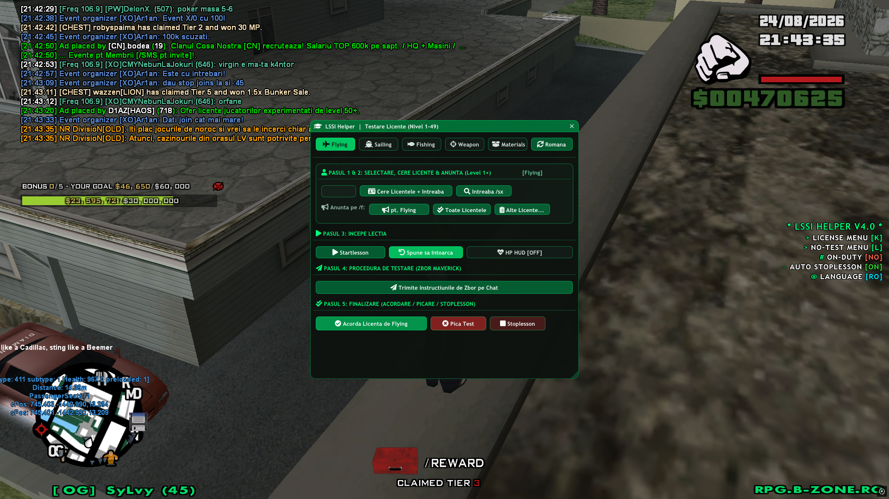
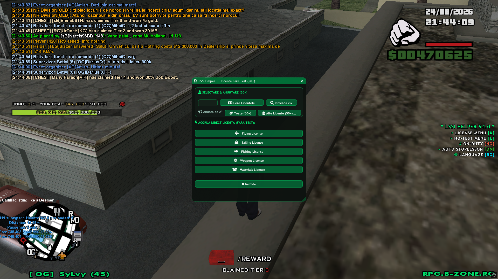
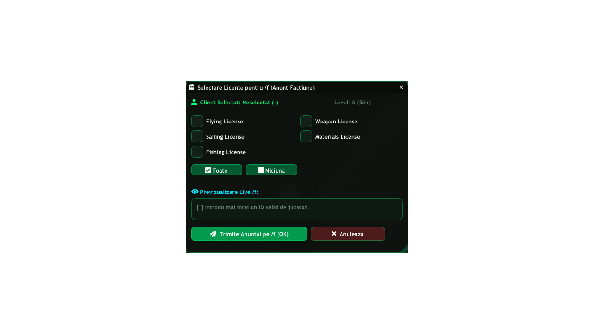
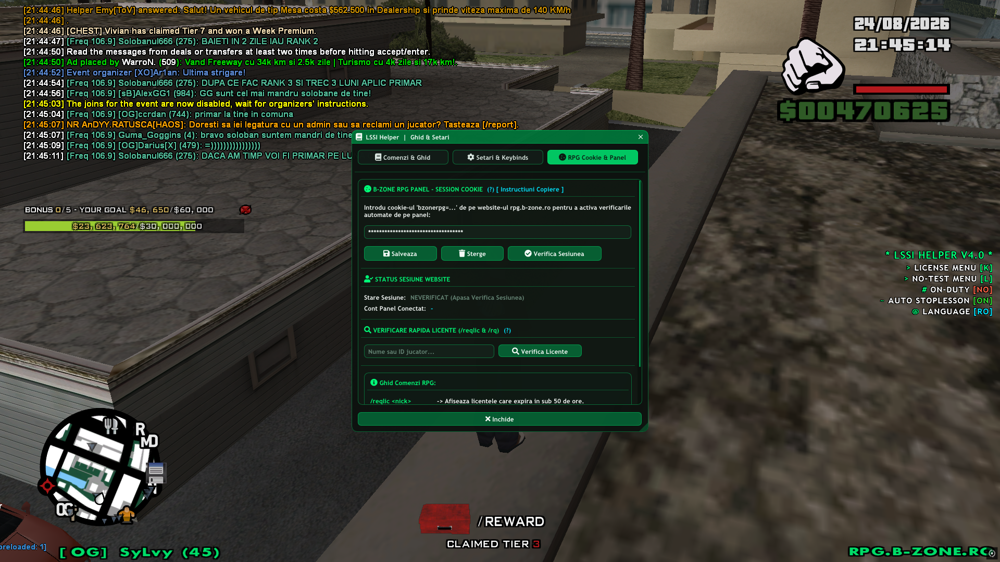
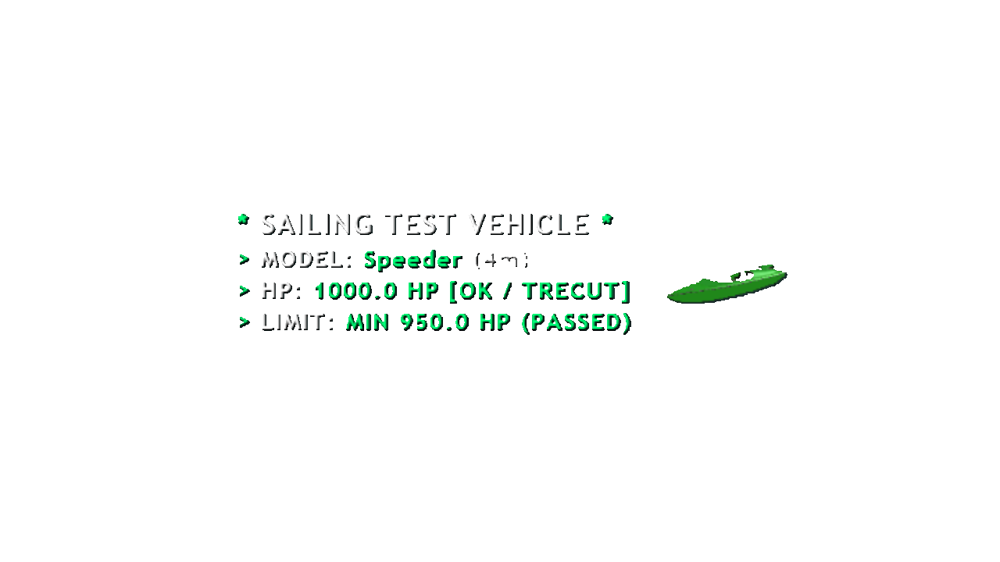
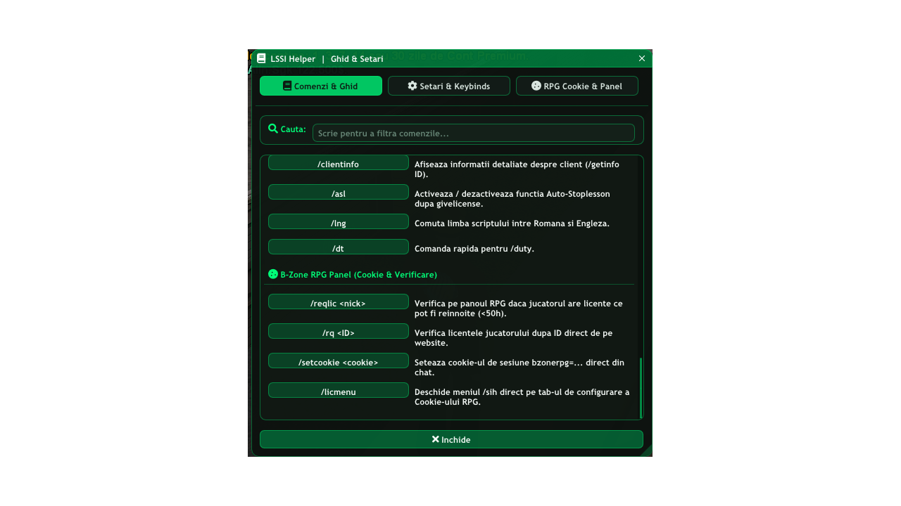
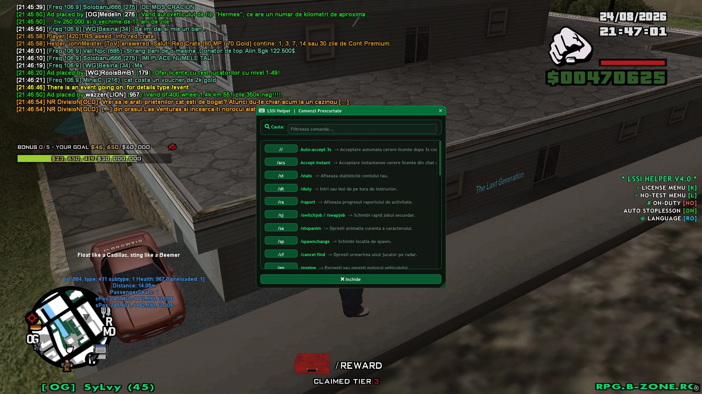

  

# 🎓 SI Helper v4.1 (LSSI & LVSI)
### Advanced MoonLoader Helper for B-Zone RPG

 

**Un helper complet, modern și ultra-optimizat dedicat membrilor facțiunilor School Instructors (LS School Instructors & LV School Instructors) de pe comunitatea B-Zone RPG.**

  
  
  
  
   
  
  
  
  

---

<b>🗺️ Cuprins & Navigare Rapidă (Click pentru a restrânge)</b>

 

| 📌 Secțiune | 📝 Detalii & Conținut | 🔗 Link Direct |
| :--- | :--- | :---: |
| **🌟 Prezentare Generală** | Viziune, arhitectură refactorizată și scopul modului | [Deschide](#-prezentare-generală) |
| **🏢 Selector Facțiune** | Suport dedicat pentru LSSI & LVSI și comanda `/selectfaction` | [Deschide](#-selector-facțiune-lssi--lvsi) |
| **✨ Funcționalități Cheie** | Noua licență Hunting (5+), 3D HUD, Web Scraper Panel RPG, Smart `/id` | [Deschide](#-funcționalități-cheie) |
| **📸 Galerie Imagini & Meniuri** | Screenshot-uri demonstrative pentru fiecare meniu | [Deschide](#-galerie-imagini--meniuri) |
| **📥 Instalare & Cerințe** | Ghid pas cu pas pentru instalare și dependențe | [Deschide](#-instalare--cerințe) |
| **📋 Tabel Comenzi Complete** | Toate cele 40+ comenzi structurate pe tabele (actualizate v4.1) | [Deschide](#-tabel-comenzi-complete) |
| **📜 Changelog (v4.1 vs v4.0)** | Suport complet Hunting License, formatare multiline $\le 128$ chars & optimizări | [Deschide](#-changelog-v41-vs-v40) |
| **👨💻 Autor & Credite** | Contact Discord și informații despre autor | [Deschide](#-autor--credite) |

---

## 🌟 Prezentare Generală

**SI Helper v4.1** reprezintă asistentul complet de ultimă generație pentru instructori. Construit pe o arhitectură modulară curată și integrat cu tema modernă **#00FF78 Emerald Neon Dark**, modul oferă suport complet pentru ambele facțiuni (**LSSI** și **LVSI**), automatizări pentru toate cele 6 licențe (inclusiv noua licență **Hunting License** pentru Level 5+), teste practice și teoretice (1-49), acordare fără test (50+), interogare directă pe panoul RPG via cookie-uri de sesiune, HUD 3D calibrat și rezolvare inteligentă a clan-tag-urilor.

---

## 🏢 Selector Facțiune (LSSI / LVSI)

Modul se adaptează instantaneu facțiunii din care faci parte:
- **LS School Instructors (LSSI):** Comanda principală `/lssi`, titluri LSSI, prefix chat `[LSSI Helper]`.
- **LV School Instructors (LVSI):** Comanda principală `/lvsi`, titluri LVSI, prefix chat `[LVSI Helper]`.
- **Comenzi de comutare:** `/selectfaction`, `/setfaction` sau din meniul grafic `/sih` ➔ Tab 2 (Setări).

---

## ✨ Funcționalități Cheie

- 🎯 **Noua Licență Hunting (Level 5+):** Suport nativ complet pentru noul test introdus pe server:
  - Tab dedicat în `/lssi` și `/lvsi` cu iconiță FontAwesome (🐾) și protecție automată de nivel ($\ge 5$).
  - Comandă dedicată de start: `/sthunt <ID>`.
  - Comenzi rapide pentru întrebări: `/hunt1` până la `/hunt6`.
  - Întrebări bilingve (Română / Engleză) și sistem multiline `printAnswer` ce împarte automat răspunsurile lungi (precum cele 15 resurse de jupuire) pe 2-3 rânduri în chat, respectând strict limita de 128 de caractere din SA-MP.
- 🎨 **Design Modern ImGui (#00FF78 Neon Dark):** Margini rotunjite, pictograme FontAwesome 5/6, animații fluide de tranziție (`Fade`) și suport bilingv (Română / Engleză) cu comutator instant în navbar.
- 🏎️ **Preview 3D Calibrat & HUD Vehicul:** Randare nativă SA-MP a Maverick-ului și Speeder-ului fără fundal negru, rotit spre textul informativ, însoțit de bara de viață în timp real și buton local de toggle `[HP HUD ON/OFF]`.
- 🍪 **Web Scraper Nativ Panou RPG (`effil_http`):** Interoghează website-ul B-Zone direct din joc pentru a vedea ce licențe pot fi reînnoite (<50h) fără a necesita fișiere externe (acum cu suport și pentru licența Hunting).
- 🔎 **Sistem Inteligent `/id` pentru Nickname & Clan-Tags:** Comanda `/rq <ID>` trimite automat `/id` în fundal, suprimă linia serverului din chat și extrage automat numele curat al contului (indiferent dacă tag-ul de clan este la început precum `[XO]neymar.jr` sau la sfârșit precum `Adelin24[x]`).
- 📋 **Noul Dialog "Alte Licențe" cu Live Preview:** Fereastră dedicată cu 6 checkbox-uri interactive pentru orice combinație de licențe (Flying, Sailing, Fishing, Weapon, Materials, Hunting), previzualizare în timp real a mesajului pe `/f` și formatare inteligentă (*"toate licentele"* când sunt bifate toate).
- ⛵ **Trasee Complete de Navigație (Sailing):** Butoane dedicate pentru `Sail LS (Lighthouse)`, `Sail LV (Old NG)` și `Sail SF (Bayside Docks)`.
- ⌨️ **Ghid Interactiv cu Căutare Live (`/sih`) & Scurtături (`/short`):** Filtrare instantanee în peste 40 de comenzi și capturator grafic pentru setarea tastelor rapide (Keybinds).

---

## 📸 Galerie Imagini & Meniuri

### 1. Meniul Principal de Testare Licențe (`/lssi` / `/lvsi` - Level 1-49)

*Meniul interactiv cu 6 tab-uri pentru testarea licențelor Flying, Sailing, Fishing, Weapon, Materials și Hunting (Level 5+), selector de limbă și pași structurați.*

---

### 2. Meniul Licențe Fără Test (`/notest` - Level 50+)

*Acordare rapidă fără test pentru jucătorii cu nivel 50+, cerere licențe și anunțare pe `/f` pentru toate cele 6 licențe.*

---

### 3. Dialogul "Alte Licențe" cu Previzualizare Live pe `/f`

*Dialog dedicat cu selecție multiplă între cele 6 licențe și previzualizare în timp real a mesajului de facțiune.*

---

### 4. Panoul RPG & Session Cookie (`/sih` Tab 3 / `/licmenu`)

*Configurare cookie de sesiune, verificare status conexiune website și căutare rapidă licențe.*

---

### 5. Preview 3D Vehicul & HUD Bară HP (Maverick / Speeder)

*Model 3D Textdraw calibrat orientat spre text, cu viața în timp real și buton local de toggle.*

---

### 6. Ghid Interactiv de Comenzi, Setări & Selector Facțiune (`/sih`)

*Sistem de căutare live în toate comenzile modului, selector LSSI / LVSI și capturator grafic de taste.*

---

### 7. Hub Scurtături Rapide (`/short`)

*Peste 30 de scurtături utile pentru activitatea de zi cu zi.*

---

## 📥 Instalare & Cerințe

### Cerințe:
1. **GTA San Andreas** cu **SA-MP 0.3.7-R1**
2. **MoonLoader v0.26** sau mai nou
3. Bibliotecile necesare (incluse în mod standard cu MoonLoader):
   - `imgui`
   - `sampfuncs`
   - `effil_http` (pentru interogarea panoului RPG)
   - `vkeys` & `inicfg`
   - Fontul **FontAwesome** în `moonloader/resource/fonts/`

### Pași de Instalare:
1. Descarcă fișierul `LSSI_helper4.1.lua`.
2. Plasează fișierul în folderul tău `GTA San Andreas/moonloader/`.
3. Asigură-te că nu ai alte versiuni vechi ale helperului (`LSSI_helper4.0.lua`, `LSSI_helper3.2.lua` etc.) în folderul `moonloader/`.
4. Intră în joc sau apasă **CTRL+R** pentru a încărca scriptul.

---

## 📋 Tabel Comenzi Complete

### 🎓 Meniuri Principale
| Comandă | Descriere |
| :--- | :--- |
| `/lssi` / `/lvsi` / `/si` | Deschide Meniul Principal pentru Licențe Nivel 1-49 (conform facțiunii active). |
| `/selectfaction` / `/setfaction` | Comută sau alege facțiunea activă (`LSSI` / `LVSI`). |
| `/notest` | Deschide Meniul pentru Licențe Nivel 50+ (Fără test). |
| `/auto50` | Deschide Meniul de Acordare Automată în Lanț a licențelor pentru 50+. |
| `/lics` | Deschide selectorul rapid de anunțare pe `/f` pentru 50+. |
| `/lics49` | Deschide selectorul rapid de anunțare pe `/f` pentru 1-49. |
| `/otherlics` / `/flics` | Deschide Dialogul Dedicat "Alte Licențe" cu previzualizare live. |
| `/sih` | Deschide Ghidul Interactiv de Comenzi, Setările și Configuratorul de Cookie. |
| `/short` | Deschide Hub-ul cu Scurtături de Comenzi. |
| `/tc` | Ascunde cursorul de mouse ImGui în caz de blocare. |

### 🍪 Panou RPG & Verificare Licențe
| Comandă | Parametru | Descriere |
| :--- | :--- | :--- |
| `/rq <ID>` | `[ID]` | Verifică instant licențele jucătorului pe baza ID-ului (cu rezolvare automată clan-tag). |
| `/reqlic <nick>` | `[Nume]` | Verifică licențele jucătorului de pe website după Nume. |
| `/setcookie <c>` | `[Cookie]` | Setează cookie-ul `bzonerpg=...` direct din chat. |
| `/licmenu` | - | Deschide meniul `/sih` direct pe tab-ul de configurare a Cookie-ului. |

### 📢 Anunțuri pe Chat-ul Facțiunii (`/f`)
| Comandă | Parametru | Descriere |
| :--- | :--- | :--- |
| `/all <ID>` | `[ID]` | Anunță pe `/f` că jucătorul este la tine pentru toate licențele (1-49). |
| `/all50 <ID>` | `[ID]` | Anunță pe `/f` că jucătorul este la tine pentru toate licențele (50+). |
| `/atme <ID> <1-6/all>` | `[ID] [1-6]` | Anunță licențele specificate după index (1: Fly, 2: Sail, 3: Fish, 4: Weap, 5: Mats, 6: Hunt). |
| `/atme50 <ID> <1-6/all>`| `[ID] [1-6]` | Anunță licențele specificate după index pentru nivel 50+. |

### 🚗 Acțiuni & Teste
| Comandă | Descriere |
| :--- | :--- |
| `/tfly` | Trimite instrucțiunile de zbor cu Maverick-ul pe chat. |
| `/lssail` | Trimite instrucțiunile pentru traseul de barcă Los Santos (Far / Lighthouse). |
| `/lvsail` | Trimite instrucțiunile pentru traseul de barcă Las Venturas (Fosta Bază NG). |
| `/sfsail` | Trimite instrucțiunile pentru traseul de barcă San Fierro (Bayside Docks). |
| `/fish1` - `/fish4` | Trimite pe rând întrebările pentru testul Fishing. |
| `/weap1` - `/weap5` | Trimite pe rând întrebările pentru testul Weapon. |
| `/mats1` - `/mats4` | Trimite pe rând întrebările pentru testul Materials. |
| `/hunt1` - `/hunt6` | Trimite pe rând întrebările pentru testul Hunting (Level 5+). |
| `/stfly` / `/stsail` / `/stfish` / `/stweap` / `/stmats` / `/sthunt` | Pornește lecția corespunzătoare (`/startlesson ID <tip>`) (weap/hunt: nivel 5+). |
| `/tfail <ID>` | Pică testul unui jucător și oprește lecția automat. |
| `/accepted <ID>` | Întreabă pe `/sx` dacă a fost acceptată cererea jucătorului. |
| `/afvr` / `/cfvr` | Inițiază / anulează un FVR cu numărătoare inversă de 10 secunde. |
| `/gl [ID] [1-6]` | Acordă licența corespunzătoare indexului (1: Fly, 2: Sail, 3: Fish, 4: Weap, 5: Mats, 6: Hunt). |

### ⚡ Scurtături Generale (Shortcuts)
| Scurtătură | Comandă Executată | Descriere |
| :--- | :--- | :--- |
| `/dt` | `/duty` | Intri sau ieși de pe tura de instructor. |
| `/ra` | `/raport` | Verifică progresul raportului de activitate. |
| `/sj` | `/switchjob` / `/swapjob` | Schimbă rapid jobul secundar. |
| `/sa` | `/stopanim` | Oprește animația curentă a caracterului. |
| `/sp` | `/spawnchange` | Schimbă locația de spawn. |
| `/cf` | `/cancel find` | Oprește urmărirea radar a unui jucător. |
| `/bg` | `/buygun deagle 100` + `m4 200` + `rifle 100` | Cumpără setul de arme dintr-un Gun Shop. |
| `/rr` | `/repair` + `/refill` | Repară și alimentează vehiculul. |
| `/rl <ID>` | `/requestlicenses <ID>` | Cere licențele unui jucător. |
| `/fd <ID>` | `/find <ID>` | Urmărește un jucător pe radar. |
| `/acc <ID>` | `/accept needlicense <ID>` | Acceptă cererea de licență a unui jucător. |
| `/sl` | `/stoplesson <clientid>` | Oprește lecția clientului curent salvat. |
| `/cmc` | - | Curăță chat-ul (100 linii libere). |

---

## 📜 Changelog (v4.1 vs v4.0)

<b>👉 Click aici pentru a vedea noutățile din v4.1</b>

 

### 🏹 1. Suport Complet pentru Noua Licență Hunting (Level 5+)
- **Tab Nou în Interfață:** Adăugat cel de-al 6-lea tab în meniul principal `/lssi` / `/lvsi` cu iconiță FontAwesome (🐾 `fa.ICON_FA_PAW`).
- **Verificare Automată de Nivel (Level 5+):** La fel ca la licența Weapon, butonul *Startlesson* și comanda `/sthunt <ID>` verifică automat dacă jucătorul are cel puțin nivelul 5 înainte de a iniția lecția.
- **Întrebări & Răspunsuri Bilingve (RO / EN):**
  1. *Ce primești dacă ucizi un animal fără licență? / What do you receive if you kill an animal without a valid Hunting License?* $\rightarrow$ **Wanted 1**
  2. *De ce altă licență ai nevoie pentru a vâna? / What other license do you need to hunt, besides the Hunting License?* $\rightarrow$ **Weapon License**
  3. *Ce primești dacă jupoi un animal fără licență? / What do you receive if you skin an animal without a valid Hunting License?* $\rightarrow$ **Wanted 1**
  4. *Unde poți vinde resursele obținute? / Where can you sell the resources obtained from the Hunter job?* $\rightarrow$ **Hunter Vendor**
  5. *Ce comandă folosești pentru a începe lucrul la job? / Which command do you need to use to start working at the Hunter job?* $\rightarrow$ **/work**
  6. *Enumeră 4 resurse pe care le poți obține după jupuire / Name 4 resources you can obtain after skinning an animal* $\rightarrow$ Lista completă de 15 resurse.
- **Formatare Multiline Inteligentă (`printAnswer`):** Întrebarea 6 afișează răspunsul împărțit optim pe 3 rânduri în chat, fiecare rând având sub 105 caractere (respectând strict limita SA-MP de 128 caractere per mesaj).
- **Comenzi de Chat Dedicate:** Comenzi rapide `/hunt1` până la `/hunt6` (fără comenzi secundare inutile).
- **Integrare în Sistemul de Acordare Directă & Anunțuri:** Suport complet pentru `/gl <ID> 6`, `/atme <ID> 6` și `/atme50 <ID> 6`.
- **Extindere Meniu No-Test & Auto50:** Hunting License este integrată nativ în `/notest`, `/auto50` și în dialogul "Alte Licențe" (`/otherlics`).
- **Web Scraper & Chat Hooks:** Recunoaștere automată la acordarea licenței pe chat și suport pentru interogarea statusului din Panoul RPG.

### 🎨 2. Rafinări de Interfață & Ajustări Grafice
- **Optimizare Navbar:** Lățimea butonului *Materials* a fost mărită la 98px pentru vizibilitate perfectă a textului alături de noul buton *Hunting*.
- **Calibrare Fereastră:** Lățimea ferestrei principale a fost setată la 670px pentru a acomoda confortabil toate cele 6 tab-uri fără scroll orizontal.
- **Grid Butoane Întrebări:** Dispunere echilibrată 2 rânduri x 3 coloane pentru întrebările de Hunting în meniul GUI.
- **Actualizare Ghid `/sih`:** Corectat indexul comenzilor de Weapon (`/weap1-5`) și adăugată comanda `/hunt(1-6)`.

 

<b>📜 Istoric Versiuni Anterioare: Changelog v4.0 vs v3.2 (Arhivă)</b>

 

### 🌟 1. Interfață Grafică Modernă & Design (#00FF78 Neon Dark)
- Înlocuit stilul ImGui clasic cu o temă modernă **#00FF78 Emerald Neon Dark**, colțuri rotunjite, fundaluri glassmorphic și iconițe vectoriale **FontAwesome 5/6**.
- Tranziții fluide de fade (`animAlphas`) și comutator bilingv persistent (`[ 🔄 Romana / English ]`) în navbar.

### 🏢 2. Suport Dual de Facțiuni (LSSI & LVSI)
- Comandă dedicată `/selectfaction [LSSI/LVSI]` și panou grafic în `/sih` Tab 2.
- Toate mesajele, titlurile și comenzile se adaptează instantaneu între LSSI și LVSI.

### 🏎️ 3. Randare 3D Modele Vehicule & HUD Calibrat
- Randare nativă SA-MP a Maverick-ului și Speeder-ului fără fundal negru, orientat spre text.
- Bară HP dinamică în timp real și buton local de toggle `[ HP HUD ON/OFF ]`.

### 🍪 4. Integrare Panou RPG B-Zone & Session Cookie
- Web Scraper asincron nativ via `effil_http` direct în script.
- Configurare cookie `bzonerpg=...` din `/sih` Tab 3 / `/licmenu` cu ghid pas cu pas.

### 🔎 5. Sistem Inteligent `/id` pentru Nickname & Clan Tags
- Interogare automată `/rq <ID>` cu suprimare linie server din chat și parser universal de clan tags la început sau la sfârșit (`[XO]neymar.jr` sau `Adelin24[x]`).

### 📋 6. Noul Dialog "Alte Licențe" cu Live Preview pe `/f`
- Fereastră dedicată (`/otherlics` / `/flics`) cu preview în timp real al mesajului de facțiune.

### ⛵ 7. Trasee Navigație Complete (Sailing)
- Butoane dedicate pentru toate cele 3 trasee: LS Lighthouse, LV Old NG, SF Bayside Docks.

---

## 👨💻 Autor & Credite

- **Autor:** SyLvy
- **Discord:** `sylwy`
- **Comunitate:** [B-Zone RPG](https://rpg.b-zone.ro)
- **Facțiuni:** LS School Instructors & LV School Instructors

---

Made with ❤️ for School Instructors Community.

